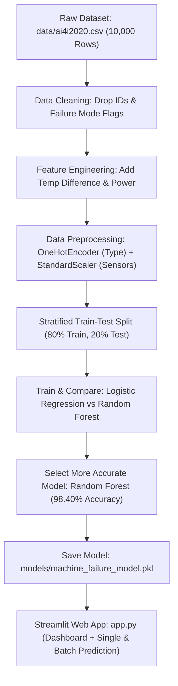

# SmartMaintain: Machine Failure Prediction

A simple, easy-to-understand Machine Learning project for predicting machine failures using sensor data from the AI4I 2020 Predictive Maintenance dataset.

Built with **Python**, **Scikit-learn**, and **Streamlit**.

---

## 📌 Project Overview (Simple Explanation)

In factories, machines (like CNC milling cutters) break down when they get too hot, run at excessive torque, or when cutting tools get worn out. 

Instead of waiting for a machine to break down (which costs a lot of time and money), **SmartMaintain** uses Machine Learning to look at real-time sensor readings and answer two questions:
1. **Will this machine fail?** (0 = Normal, 1 = Failure)
2. **What is the failure risk percentage?** (Low Risk, Moderate Risk, High Risk)

---

## 🔄 Project Architecture & Flowchart



---

## 📂 Project Structure

```
SmartMaintain/
│
├── data/
│   ├── ai4i2020.csv              # Original dataset (10,000 records)
│   └── sample_batch_test.csv     # 10-row test CSV for batch upload
│
├── models/
│   └── machine_failure_model.pkl # Saved Random Forest Pipeline
│
├── notebooks/
│   └── analysis.ipynb            # Interactive notebook (EDA, Model Comparison & Tuning)
│
├── train.py                      # (~85 lines) Feature engineering, training, comparison & saving
├── app.py                        # (~170 lines) Streamlit web application
├── requirements.txt              # Required libraries
└── README.md                     # Project documentation & viva guide
```

---

## ⚙️ Features Used in the Model

We use **only 6 sensor inputs** from the machine. We strictly exclude row IDs and failure-mode columns to prevent **data leakage**.

| Feature Name | Unit | What it Represents |
| :--- | :---: | :--- |
| **Type** | L / M / H | Product quality tier (L = Low 60%, M = Medium 30%, H = High 10%) |
| **Air temperature** | K | Room / ambient temperature (~300 K / 27 °C) |
| **Process temperature** | K | Cutting zone temperature inside the machine (~310 K / 37 °C) |
| **Rotational speed** | rpm | Spindle rotational speed (~1500 rpm) |
| **Torque** | Nm | Resistance torque against the tool (~40 Nm) |
| **Tool wear** | min | Total machining time on the cutting tool (0 to 250 min) |

### 🛠️ The 2 Engineered Features (Very Easy to Explain)

In `train.py` and `app.py`, we calculate 2 simple physical features from the raw sensors:

1. **Temperature Difference [K]**:
   $$\text{Temperature Difference} = \text{Process Temperature} - \text{Air Temperature}$$
   *Explanation*: Shows if cooling is working. If the difference is too low ($< 8.6\text{ K}$), the machine is overheating because heat cannot escape (Heat Dissipation Failure).
2. **Mechanical Power [W]**:
   $$\text{Mechanical Power} = \text{Torque} \times \left(\frac{2 \times \pi \times \text{Rotational Speed}}{60}\right)$$
   *Explanation*: Calculates actual mechanical power drawn by the motor in Watts ($\text{Power} = \text{Torque} \times \text{angular velocity}$). High power spikes mean the motor is overloaded (Power Failure).

---

## 📊 Model Training & Comparison

In `train.py`, we train **only 2 models** using `class_weight='balanced'` on an 80:20 stratified split:
1. **Logistic Regression**
2. **Random Forest Classifier**

### Comparison Table:
| Metric | Model 1: Logistic Regression | Model 2: Random Forest Classifier (**Selected**) |
| :--- | :---: | :---: |
| **Accuracy** | 85.90% | **98.40%** |
| **Precision** | 17.77% | **73.68%** |
| **Recall** | **86.76%** | 82.35% |
| **F1-Score** | 0.2950 | **0.7778** |

### Which Model is Selected and Why?
`train.py` compares their test accuracy and automatically selects **Random Forest Classifier** because:
- **Higher Accuracy**: 98.40% vs 85.90%.
- **Far Fewer False Alarms**: Logistic Regression has a precision of only 17.77% (triggering hundreds of false alarms). Random Forest achieves 73.68% precision while catching over 82% of true failures.

*(In `notebooks/analysis.ipynb`, we also show hyperparameter fine-tuning with `GridSearchCV`, which pushes Random Forest accuracy up to 99.10% and F1-score to 0.8594).*

---

## 🚀 How to Run the Project (Quick Steps)

### Step 1: Install Dependencies
```bash
pip install -r requirements.txt
```

### Step 2: Train Model & Select Best
```bash
python train.py
```
*Output: Evaluates both models, selects Random Forest with 98.40% accuracy, and saves it to `models/machine_failure_model.pkl`.*

### Step 3: Launch Streamlit Web App
```bash
streamlit run app.py
```
Open `http://localhost:8501` in your browser.

*(To view interactive EDA and GridSearchCV tuning, open `notebooks/analysis.ipynb` in VS Code or Jupyter Lab).*

---

## 🖥️ What Does the Streamlit Web App Do?

1. **Dashboard Tab**:
   - Shows total records (10,000), normal machines (9,661), failures (339), and fleet failure rate (3.39%).
   - Bar charts for normal vs. failure distribution and failures by product type.
2. **Single Prediction Tab**:
   - Sliders/input boxes for the 6 operating sensors with sensible defaults.
   - Click **"Predict Failure"** to get:
     - Predicted status: `NORMAL` or `FAILURE`
     - Failure probability percentage (e.g., `12.5%`)
     - Risk category: **Low Risk** ($<10\%$), **Moderate Risk** ($10\%-30\%$), **High Risk** ($\ge 30\%$).
     - Practical maintenance suggestions (e.g., "Replace tool insert", "Inspect cooling vents").
3. **Batch Prediction Tab**:
   - Upload any CSV with machine rows.
   - Predicts all rows at once, displays summary counts, and allows downloading predictions as a CSV.

---

## 🎓 Viva / Exam Questions Cheat Sheet (If Professor Asks)

**Q1: Why did you drop `UDI` and `Product ID`?**  
> *"They are just row counters and serial numbers. They don't have any physical sensor information, so including them would just add noise."*

**Q2: Why did you remove `TWF`, `HDF`, `PWF`, `OSF`, `RNF` from the input features?**  
> *"That would cause data leakage! Those 5 columns are failure modes that tell why a machine failed after the fact. If we fed them to the model, it would be cheating."*

**Q3: Why can't we just look at Accuracy?**  
> *"Because 96.6% of the data is Normal (class imbalance). A dumb model that always guesses 'Normal' without learning anything still gets 96.6% accuracy, but fails to catch any broken machine. That's why we also evaluate Recall and F1-Score."*

**Q4: What preprocessing did you do?**  
> *"We used Scikit-Learn's `ColumnTransformer`: One-Hot Encoding for the categorical `Type` column, and `StandardScaler` for the numerical sensor readings so all features are normalized."*

**Q5: What are your 2 engineered features?**  
> *"Temperature Difference (Process Temp minus Air Temp) which tracks heat dissipation, and Mechanical Power (Torque times angular speed in rad/s) which tracks motor workload in Watts."*

**Q6: Between Logistic Regression and Random Forest, which is selected in `train.py`?**  
> *"Random Forest Classifier is selected because it achieves 98.40% accuracy compared to 85.90% for Logistic Regression, and avoids excessive false alarms."*

---

## ⚠️ Limitations
- **Synthetic Data**: AI4I 2020 is a synthetic dataset based on physical equations, not live factory vibration sensors.
- **Point-in-Time**: Predicts based on single sensor snapshots rather than time-series sequences.
- **Thresholds**: The risk categories (10% and 30%) are illustrative engineering thresholds for demonstration.
